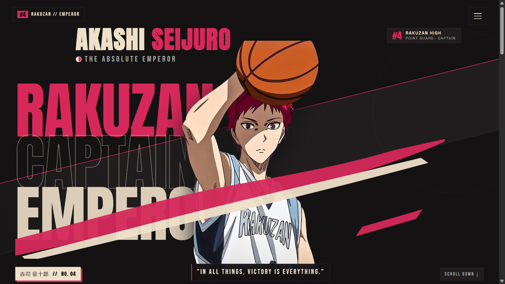
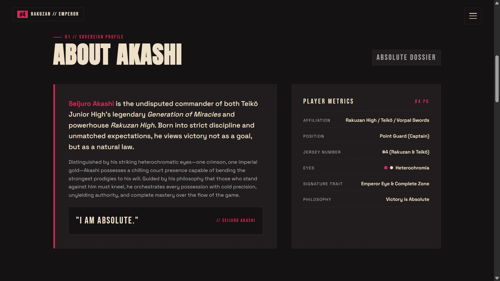
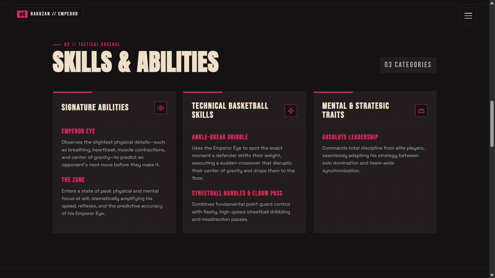
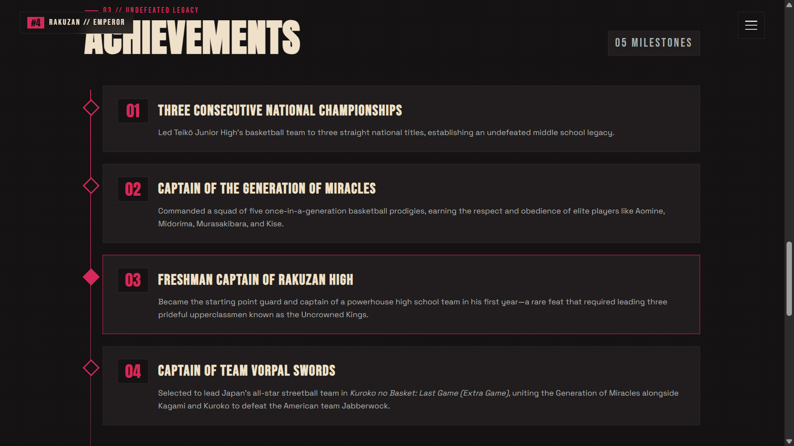
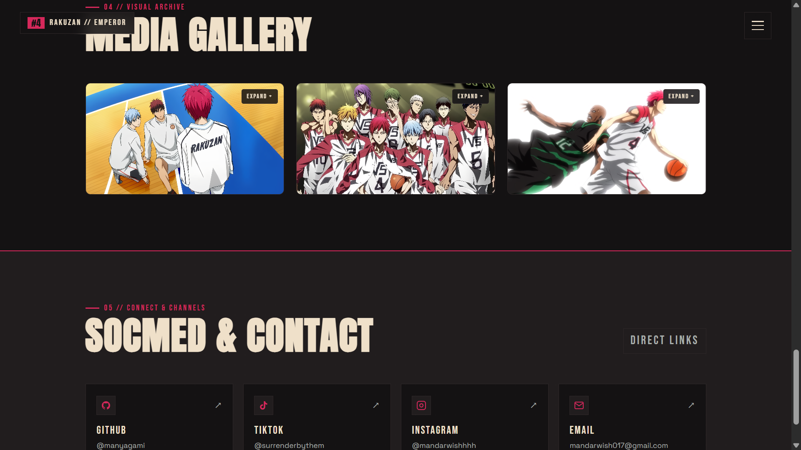
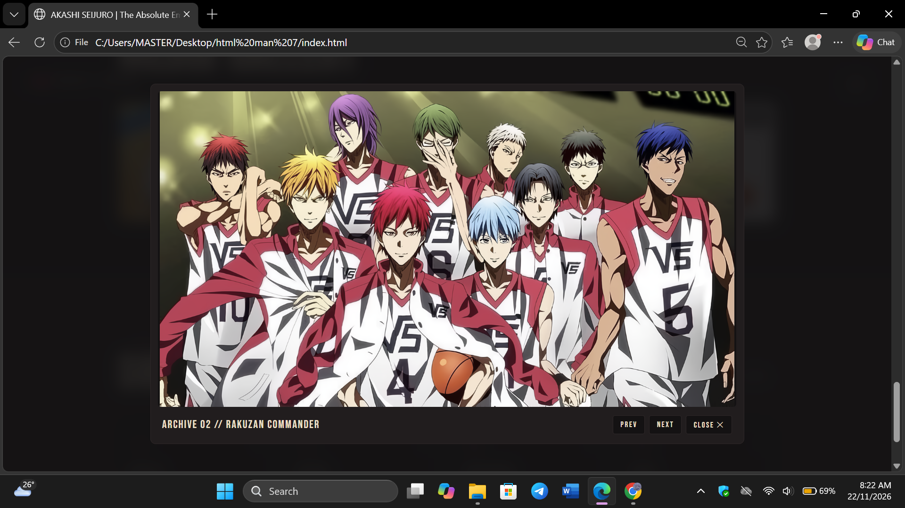

# #4 // AKASHI SEIJURO — The Absolute Emperor

A dark-themed, editorial-style static HTML website dedicated to **Seijuro Akashi**, captain of the *Generation of Miracles*, *Rakuzan High*, and *Team Vorpal Swords* from the anime/manga series ***Kuroko no Basket*** (*Kuroko's Basketball*).

---

## 📸 Preview

| 1. Hero Section | 2. Sovereign Profile (`About Akashi`) |
| :---: | :---: |
|  |  |

| 3. Tactical Arsenal (`Skills & Abilities`) | 4. Undefeated Legacy (`Achievements`) |
| :---: | :---: |
|  |  |

| 5. Media Gallery & Contact | 6. Interactive Lightbox Viewer |
| :---: | :---: |
|  |  |

---

## 📖 Context

This project is a character dossier and visual showcase built with pure HTML, CSS, and JavaScript (static web). Inspired by sports editorial layouts and tactical HUD interfaces, it presents Akashi Seijuro's lore, abilities, and milestones using a high-contrast dark palette (`#111` charcoal, crimson-magenta, and warm cream typography).

### Key Sections Included
- **Hero Banner:** Features character art, Rakuzan `#4` badge, navigation drawer toggle, and signature quote (*"In all things, victory is everything."*).
- **01 // Sovereign Profile (`About Akashi`):** Character biography alongside a structured **Player Metrics** card (affiliation, position, jersey number, heterochromia eyes, signature traits, and philosophy).
- **02 // Tactical Arsenal (`Skills & Abilities`):** Categorized breakdown into *Signature Abilities* (Emperor Eye, The Zone), *Technical Basketball Skills* (Ankle-Break Dribble, Streetball Handles & Elbow Pass), and *Mental & Strategic Traits* (Absolute Leadership).
- **03 // Undefeated Legacy (`Achievements`):** A vertical milestone timeline highlighting his championships and captaincies across Teikō, Rakuzan High, and Team Vorpal Swords.
- **04 // Visual Archive (`Media Gallery`):** Interactive image cards with an `EXPAND +` lightbox modal supporting `PREV`, `NEXT`, and `CLOSE` controls.
- **05 // Connect & Channels (`Socmed & Contact`):** Direct links to the creator's social media and contact channels.

---

## 🚀 How to Use

### Running Locally
1. **Clone the repository** or download the ZIP:
   ```bash
   git clone https://github.com/manyagami/seijuro-akashi-portfolio.git
   ```
2. **Open the project folder** and make sure all HTML, CSS, JS, and image files remain in the same directory structure.
3. **Launch `index.html`** directly in any modern web browser (Chrome, Microsoft Edge, Firefox, etc.)—or run it with a local development server (such as the Live Server extension in VS Code).

### Navigating the Site
- **Scroll** down to explore each dossier section sequentially, or use the **Menu (`☰`)** button in the top-right corner to jump between sections.
- In the **Media Gallery** section, click **`EXPAND +`** on any image card to open the full-screen archive viewer.
- Use **`PREV`**, **`NEXT`**, or **`CLOSE ×`** inside the modal to browse through the gallery.

---

## 🎖️ Credits

- **Design & Development:** Created by [@manyagami](https://github.com/manyagami)
- **Character & Original IP:** Seijuro Akashi and *Kuroko no Basket* (*Kuroko's Basketball*) are created by Tadatoshi Fujimaki and animated by Production I.G. All character renders, anime stills, and lore belong to their respective copyright holders. This website is made purely as a non-commercial fan/portfolio project.

---

## 🔗 Connect

Feel free to reach out, follow, or check out more projects through the channels below:

- **GitHub:** [https://github.com/manyagami](https://github.com/manyagami)
- **TikTok:** [https://www.tiktok.com/@surrenderbythem](https://www.tiktok.com/@surrenderbythem)
- **Instagram:** [https://www.instagram.com/mandarwishhhh](https://www.instagram.com/mandarwishhhh)
- **Email (Gmail):** [mandarwish017@gmail.com](mailto:mandarwish017@gmail.com)
